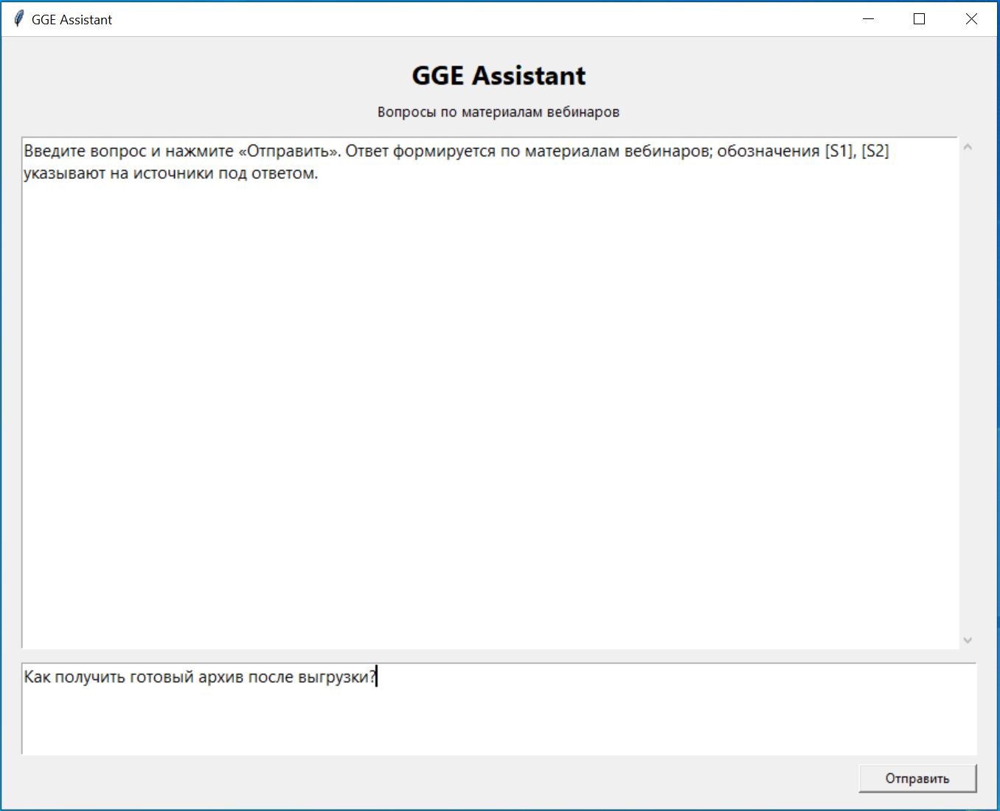
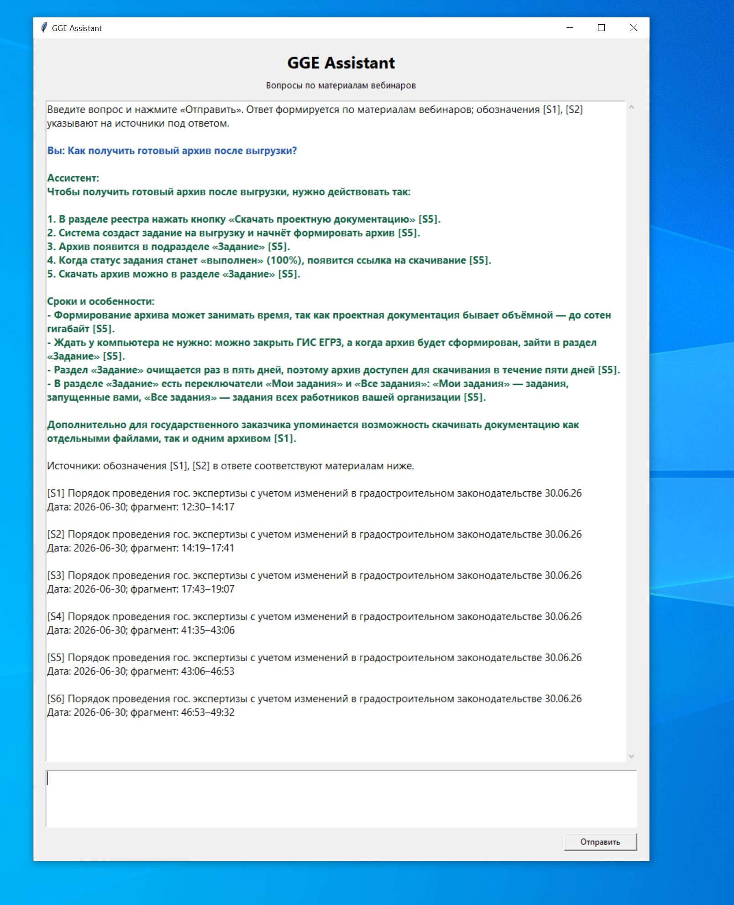
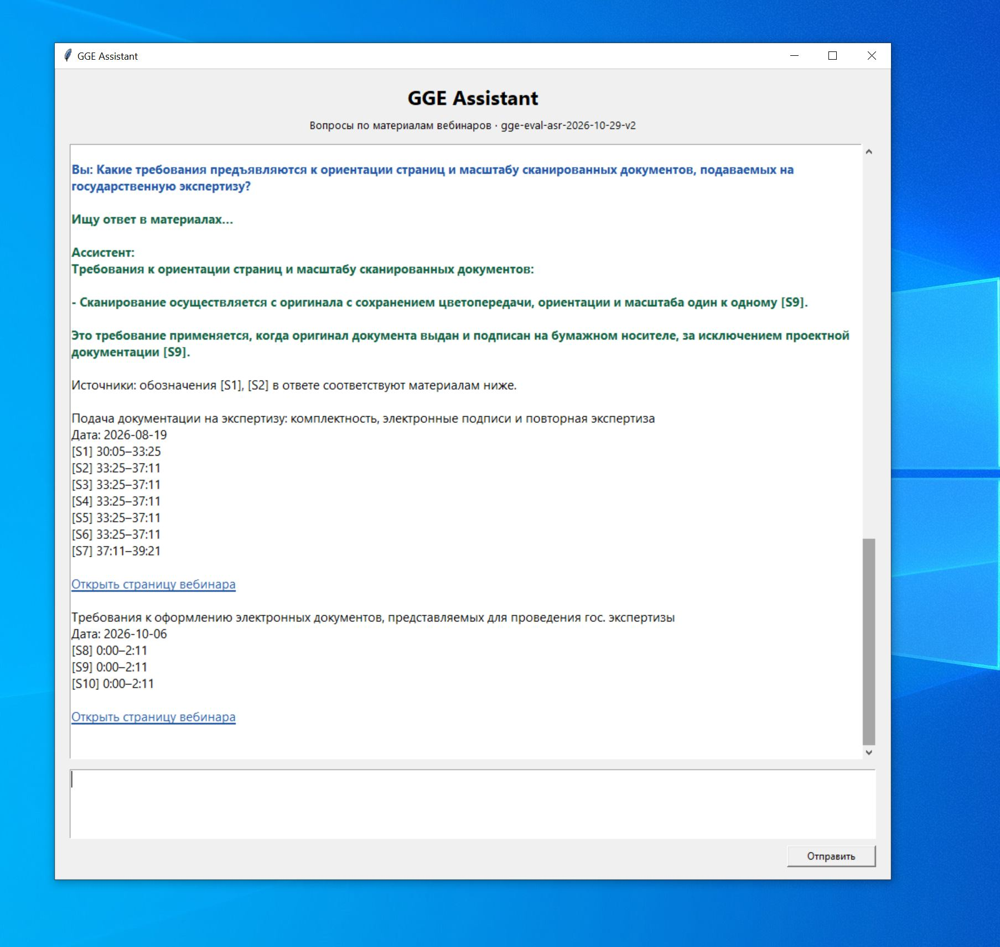
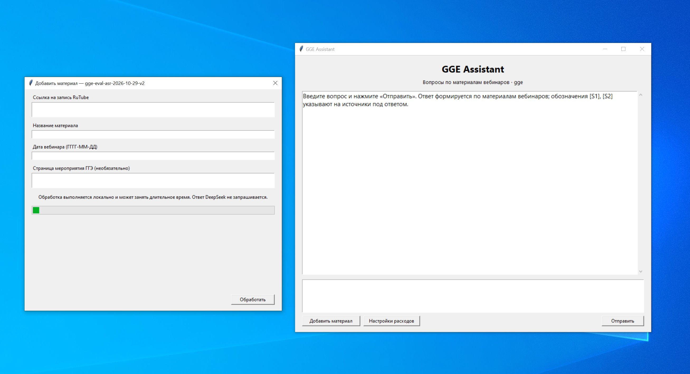
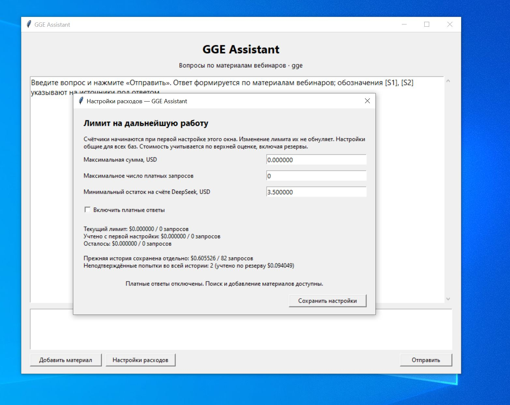
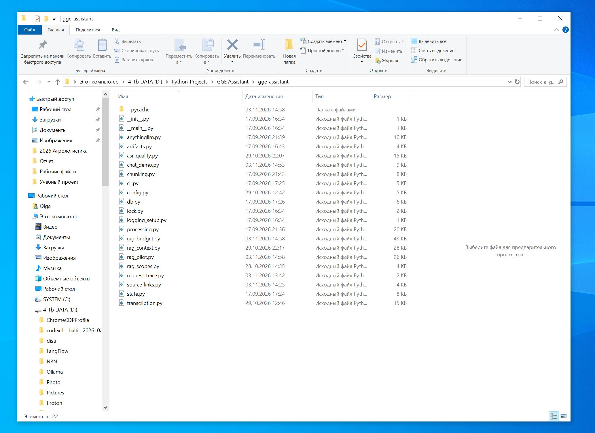

# GGE Assistant

**Помощник для поиска ответов в видеозаписях вебинаров Главгосэкспертизы России.**

Проект превращает длинные записи в базу знаний: получает медиаданные, локально распознаёт речь, проверяет качество расшифровки, индексирует текст и отвечает на вопросы с указанием материала и времени нужного фрагмента.

## Зачем создан проект

Вебинары содержат практические разъяснения по подаче документации, работе с ГИС ЕГРЗ и проведению экспертизы. Чтобы найти ответ вручную, приходится просматривать длинные записи. GGE Assistant позволяет задать вопрос в окне чата, прочитать ответ и перейти к первоисточнику для проверки.

Кейс выбран как практическая задача, в которой объединяются работа с видео, локальные модели распознавания речи, поисковая база и языковая модель. Ответ можно сопоставить с конкретным фрагментом записи.

## Что реализовано

- **Получение медиаданных по ссылке.** `yt-dlp` получает доступный аудио- или видеопоток; FFmpeg выделяет и приводит аудио к единому формату. Для расшифровки выбирается отдельная аудиодорожка, а при её отсутствии — видеопоток до 360p, если он доступен: скачивать HD-видеоряд для распознавания речи не требуется. Можно обработать и локальный медиафайл. Полный видеофайл не требуется постоянно хранить на диске.
- **Локальная расшифровка речи.** `faster-whisper` выполняет Whisper `large-v3` на компьютере пользователя. В проверенной конфигурации используется NVIDIA GPU, CUDA и `float16`. Аудиозапись не отправляется в облачный сервис распознавания.
- **Проверка качества расшифровки.** Два прохода распознавания с разными настройками, поиск расхождений и возможных пропусков речи, выборочные повторы коротких участков. Сырые варианты и отчёт сохраняются, неустойчивые фрагменты исключаются из принятого текста. Также проверяются временные границы: фразы с некорректными интервалами сохраняются в сыром результате и исключаются из поисковой расшифровки; такой результат отмечается как частичный. Это автоматическая проверка устойчивости, а не редакторская сверка всей записи.
- **Текст с временными отметками.** Результат сохраняется в JSON и TXT; текстовые фрагменты связаны с исходным материалом и временем записи.
- **База знаний в AnythingLLM Desktop.** Документы загружаются и связываются с рабочим пространством с проверкой результата. В локальной установке используется embedding-модель `multilingual-e5-small`.
- **Улучшенный поиск контекста.** Семантический поиск AnythingLLM объединяется с локальным полнотекстовым поиском SQLite FTS5. Для ответа восстанавливаются более полные тематические фрагменты и соседний контекст.
- **Окно чата и добавление материалов.** Многострочный ввод, вставка текста, ответы на русском языке, группировка источников по материалам, временные диапазоны и кликабельные ссылки на страницы записей. Кнопка «Добавить материал» открывает форму для пополнения базы без ввода команд.
- **Контроль выполнения и расходов.** Состояния обработки хранятся в SQLite. Повторные запуски используют готовые результаты. Кнопка «Настройки расходов» позволяет включить платные ответы и задать сумму и число запросов; до настройки они отключены. Обращения к DeepSeek проходят через журнал бюджета; ответы кешируются, технические этапы записываются без ключей и текста запросов.

## Как это работает

```text
Ссылка на запись / локальный файл
          ↓
yt-dlp → FFmpeg → аудио
          ↓
Whisper large-v3 локально → проверка расшифровки
          ↓
JSON/TXT с тайм-кодами → фрагменты → AnythingLLM
          ↓
Вопрос → семантический поиск + SQLite FTS5
          ↓
Расширенный контекст → DeepSeek → ответ, источники и ссылки
```

**Распознавание речи и генерация ответа — разные этапы.** Whisper работает локально; DeepSeek получает вопрос и отобранные текстовые выдержки, а не видео или аудио. Собственный чат использует улучшенный поиск проекта; стандартный чат AnythingLLM работает со своей цепочкой поиска.

### Зачем нужен AnythingLLM и как он связан с кодом

**AnythingLLM Desktop — база знаний, в которой приложение ищет подходящие фрагменты вебинаров.** Оно должно быть запущено во время добавления материалов и поиска. Рабочее пространство (workspace) — это отдельная коллекция документов внутри AnythingLLM.

Интеграция устроена так:

1. Python-код получает запись, локально расшифровывает её и делит текст на фрагменты с названием материала, датой и временем.
2. Модуль `anythingllm.py` через API загружает эти фрагменты в выбранное рабочее пространство. API — способ, которым две программы обмениваются данными без ручного переноса файлов.
3. AnythingLLM создаёт для текста числовые представления — embeddings. Они помогают находить фрагменты по смыслу, даже если вопрос сформулирован другими словами. В используемой локальной конфигурации за это отвечает `multilingual-e5-small`.
4. Когда пользователь задаёт вопрос в GGE Assistant, код получает результаты поиска AnythingLLM, дополняет их локальным поиском по тексту и соседними фрагментами расшифровки.
5. Код отправляет выбранные выдержки и вопрос напрямую в DeepSeek API. Полученный ответ отображается в нашем окне вместе с источниками и ссылками.

Таким образом, **AnythingLLM хранит и находит материалы, DeepSeek формулирует ответ, а Python-код связывает этапы и управляет обработкой и расходами**. Для этой работы достаточно собственного окна GGE Assistant; открывать стандартный чат AnythingLLM не требуется. Возможности подключения через API описаны в [официальной документации AnythingLLM](https://docs.anythingllm.com/features/api).

## Пример использования

Вопрос пользователя:

> Как в ГИС ЕГРЗ скачать архив проектной документации после формирования задания на выгрузку? Где проверить готовность задания и сколько времени доступно скачивание?

Ассистент находит объяснение механизма заданий, формирует ответ и указывает источники вида `[S1]`. Под ответом показываются название и дата записи, временные диапазоны и ссылка на страницу материала. Несколько выдержек одного материала объединяются в одну группу источников.

Поиск может охватывать несколько вебинаров. Если найдены выдержки из разных записей, под ответом показываются отдельные группы источников со своими ссылками и временными диапазонами.

## Технологии

| Этап | Инструменты |
|---|---|
| Получение записи и подготовка звука | yt-dlp, FFmpeg, FFprobe |
| Распознавание речи на компьютере | faster-whisper, Whisper large-v3, CTranslate2; NVIDIA CUDA в проверенной GPU-конфигурации |
| Проверка расшифровки | Сравнение двух проходов и локальное повторное распознавание спорных фрагментов |
| Хранение материалов и состояний | SQLite, JSON, TXT |
| Поиск | AnythingLLM Desktop, локальные embeddings multilingual-e5-small, SQLite FTS5 |
| Формирование ответа | DeepSeek API, отобранный контекст и обозначения источников |
| Интерфейс | Python, Tkinter |

## Скриншоты работы

**Ввод вопроса.** Пользователь вводит вопрос в многострочное поле и отправляет его ассистенту.



**Ответ и временные диапазоны.** Ассистент объясняет порядок действий и указывает фрагменты записи, с которыми можно сопоставить ответ.



**Ссылки на первоисточники.** Под ответом о сканировании документов показаны найденные материалы, их даты, временные диапазоны и ссылки на страницы записей. Обозначение `[S9]` в ответе указывает на соответствующий фрагмент видеоинструкции.



**Добавление материала.** В форме указываются ссылка на запись, название, дата и необязательная публичная страница мероприятия. После заполнения кнопка «Обработать» запускает подготовку материала для поиска.



**Настройки расходов.** Пользователь задаёт сумму и число запросов, видит использованный и оставшийся лимит. На снимке платные ответы выключены, прежняя история расходов сохранена.



## Структура проекта

На снимке показана папка исходного кода. Названия модулей соответствуют этапам обработки, поиска и формирования ответа.



```text
GGE Assistant/
├── README.md                  # Описание и запуск
├── requirements.txt           # Основные зависимости
├── config.example.ini         # Пример конфигурации
├── gge_assistant/              # Код приложения
│   ├── transcription.py        # Получение аудио и локальное распознавание
│   ├── asr_quality.py         # Проверка расшифровки
│   ├── processing.py          # Стадии обработки и загрузка
│   ├── rag_context.py         # Поиск и восстановление контекста
│   ├── rag_pilot.py           # Поиск и ответ модели
│   ├── chat_demo.py           # Окно чата
│   ├── import_dialog.py       # Форма добавления материала
│   ├── expense_dialog.py      # Форма настройки расходов
│   └── source_links.py        # Ссылки и группировка источников
├── tests/                     # Автоматические проверки
└── docs/screenshots/          # Скриншоты работы
```

## Основные файлы и функции

| Файл | Назначение |
|---|---|
| `gge_assistant/cli.py` | Команды регистрации источника, обработки, повторного запуска и просмотра состояния |
| `gge_assistant/transcription.py` | `transcribe_material()` — получение аудио, локальный ASR и сохранение расшифровки |
| `gge_assistant/asr_quality.py` | `screen_passes()` — сравнение проходов, короткие повторы и отбор устойчивого текста |
| `gge_assistant/chunking.py` | Подготовка текстовых фрагментов с метаданными и временем |
| `gge_assistant/processing.py` | `process_material()` — стадии обработки и загрузка документов |
| `gge_assistant/anythingllm.py` | Клиент AnythingLLM: документы, связь с пространством и векторный поиск |
| `gge_assistant/rag_context.py` | `ContextIndex`, `query_aspects()` — локальный индекс, разбор вопроса и сбор контекста |
| `gge_assistant/rag_pilot.py` | `prepare_index()`, `expanded_context()`, `answer()` — цепочка поиска и ответа |
| `gge_assistant/rag_scopes.py` | Привязка обозначений цитат к отдельным фрагментам |
| `gge_assistant/chat_demo.py` | Окно GGE Assistant на Tkinter |
| `gge_assistant/import_dialog.py` | Форма добавления записи, этапы обработки и фоновый запуск |
| `gge_assistant/material_import.py` | `import_material()` — регистрация записи, pipeline и проверка готовности поиска |
| `gge_assistant/source_links.py` | `SourceLinks` — страницы материалов и группировка источников |
| `gge_assistant/rag_budget.py` | `BudgetLedger`, `BudgetedDeepSeek` — учёт и ограничение платных попыток |
| `gge_assistant/spending.py` | Пользовательские лимиты, расчёт использованного/остатка и сохранение настроек без сброса истории |
| `gge_assistant/expense_dialog.py` | Окно «Настройки расходов» |
| `gge_assistant/request_trace.py` | Безопасный технический журнал этапов запроса |
| `gge_assistant/db.py`, `state.py` | Реестр материалов и состояния стадий в SQLite |
| `tests/` | Автоматические проверки механизма обработки, поиска, ссылок и бюджета |

## Требования

- Python 3.11 с Tkinter и SQLite FTS5; локальная проверенная среда — Windows.
- FFmpeg и FFprobe в `PATH` либо их пути в конфигурации.
- Существующая установка AnythingLLM Desktop с доступным API и собственным API-ключом.
- Для GPU-распознавания — совместимые NVIDIA GPU, CUDA, cuDNN и CTranslate2. Для CPU можно выбрать `device = cpu` и `compute_type = int8`; время выполнения зависит от оборудования.
- Для новых ответов — локально настроенный ключ DeepSeek и разрешённый лимит приложения.

Первоначальная загрузка модели Whisper требует сети. После загрузки распознавание выполняется локально. Поиск через AnythingLLM требует запущенного приложения; новая генерация DeepSeek — подключения к интернету.

## Установка и запуск

Из папки проекта в PowerShell:

```powershell
py -3.11 -m venv .venv
.\.venv\Scripts\python.exe -m pip install -r requirements.txt
Copy-Item config.example.ini config.ini
```

В `config.ini` задаются пути к данным и инструментам, модель распознавания и подключение AnythingLLM. Значения `ffmpeg_path` и `ffprobe_path` можно оставить стандартными, если программы доступны в `PATH`, либо указать полные пути к ним. Для работы на CPU в разделе `[whisper]` задайте `device = cpu` и `compute_type = int8`; обработка будет медленнее.

### Подключение AnythingLLM

1. Установите и запустите [AnythingLLM Desktop](https://docs.anythingllm.com/installation-desktop/overview). Если приложение уже установлено и настроено, используйте его.
2. Для новой базы создайте отдельное рабочее пространство проекта, например `gge`. Включите доступ к API и создайте ключ в разделе настроек API / Developer API. Названия пунктов могут зависеть от версии; см. [инструкцию AnythingLLM](https://docs.anythingllm.com/features/api).
3. В папке проекта создайте папку `.private`, а в ней файл `anythingllm_api_key.txt`. Вставьте в него **только ключ AnythingLLM**, одной строкой, и сохраните.
4. В разделе `[anythingllm]` файла `config.ini` укажите адрес API, путь к ключу и идентификатор рабочего пространства (slug — часть адреса пространства, которая может отличаться от отображаемого названия):

```ini
[anythingllm]
base_url = http://127.0.0.1:3001/api/v1
api_key_path = .private/anythingllm_api_key.txt
workspace_slug = gge
```

Адрес выше используется стандартной локальной установкой проекта; если у вашей установки он другой, укажите свой. Для новой базы настройте embedding-провайдер до загрузки документов. Локальный вариант выполняет индексацию на компьютере; облачный может иметь отдельную стоимость. При подключении к уже готовой базе используйте её существующую конфигурацию и embedding-модель.

### Подключение API-ключа DeepSeek

**Ключ DeepSeek и ключ AnythingLLM — два разных ключа.** Первый нужен для новых ответов языковой модели, второй — для работы с локальной базой.

1. Войдите в [кабинет DeepSeek API](https://platform.deepseek.com/api_keys) и создайте свой API-ключ. Для платных ответов на счёте API должны быть средства. Инструкция сервиса: [DeepSeek API](https://api-docs.deepseek.com/api/deepseek-api/).
2. В папке `.private` внутри проекта создайте файл **`deepseek_api_key.txt`**. В обычном текстовом редакторе вставьте туда только ключ одной строкой: без кавычек, подписи и `DEEPSEEK_API_KEY=`. Проверьте, что файл не получил двойное расширение `.txt.txt`.
3. Сохраните файл и запустите GGE Assistant из папки проекта. Код прочитает ключ автоматически; в `config.ini` вставлять его не нужно.
4. Откройте **«Настройки расходов»**, задайте допустимую сумму и число запросов, включите платные ответы и сохраните настройки. Наличие ключа само по себе платные ответы не включает.

Папка `.private` исключена из Git: ключи остаются на вашем компьютере. Их не следует добавлять в README, скриншоты или загружать на GitHub. Окно расходов сохраняет только лимиты; поля для ввода ключа в нём нет.

Дополнительно код поддерживает переменную окружения `DEEPSEEK_API_KEY` и уже сохранённый ключ DeepSeek в существующей установке AnythingLLM Desktop. Переменная окружения имеет приоритет над локальным файлом; ключ DeepSeek из настроек AnythingLLM читается, если нет ни переменной, ни файла. Для самостоятельной настройки достаточно файла, описанного выше.

### Запуск окна чата

Оставьте AnythingLLM запущенным и выполните из папки проекта:

```powershell
.\.venv\Scripts\python.exe -m gge_assistant.chat_demo
```

Окно использует базу, указанную в `config.ini`. При первом запуске добавьте вебинар по инструкции ниже. После завершения обработки введите вопрос в многострочное поле и нажмите **«Отправить»**. Обозначения `[S1]`, `[S2]` связывают утверждения ответа с выдержками под ним. Ссылка открывает страницу материала в браузере; указанный временной диапазон помогает найти нужный момент записи.

### Добавление записи через окно

После первоначальной настройки материалы добавляются через форму:

1. Запустите AnythingLLM и окно GGE Assistant с конфигурацией нужной базы.
2. Нажмите **«Добавить материал»**.
3. Вставьте прямую ссылку на запись **RuTube**, укажите название и дату вебинара в формате `ГГГГ-ММ-ДД`.
4. При наличии добавьте публичную страницу мероприятия на `edu.gge.ru` или `kb.gge.ru`: она будет использоваться в списке источников. Это отдельное необязательное поле; ссылка на страницу мероприятия не заменяет ссылку на саму запись.
5. Нажмите **«Обработать»**. Форма показывает получение аудио, локальное распознавание, проверку расшифровки, подготовку фрагментов, добавление в базу и контрольный поиск. Процент выполнения не вычисляется; этап может занимать длительное время.
6. После сообщения **«Материал доступен для поиска»** закройте форму и задайте вопрос по обновлённой базе.

Обработка выполняется в фоне. Во время неё отправка вопросов и повторное добавление временно блокируются, чтобы операции с базой не пересекались. Закрывать приложение следует после завершения обработки. Повторная ссылка распознаётся как тот же материал, а готовые этапы используются повторно. Неоднозначные ошибки загрузки требуют проверки и не вызывают автоматический повтор.

Готовность подтверждается после добавления документов в выбранную базу и проверки, что они находятся поиском. Если автоматическая проверка расшифровки исключила неустойчивые фрагменты, форма сообщает о частичном результате. Первичная настройка инструментов и API выполняется один раз по инструкции выше.

Добавление материала не вызывает DeepSeek: аудио распознаётся локально. Загрузка и индексация обращаются к RuTube и AnythingLLM; возможные расходы индексации зависят от настроенного embedding-провайдера. В проверенной установке embeddings локальные.

### Настройки расходов

Получение записи и локальная расшифровка не вызывают DeepSeek. Платное обращение возникает при формировании нового ответа; подходящий сохранённый ответ используется повторно без нового обращения к модели.

**До настройки платные ответы отключены.** Добавление материалов, локальная расшифровка и просмотр подходящих сохранённых ответов доступны без включения платной генерации.

1. Нажмите **«Настройки расходов»** в окне чата.
2. Укажите **максимальную сумму в USD** и **число платных запросов**. Принимаются десятичная точка и запятая: `0.10` или `0,10`.
3. Укажите **минимальный остаток на счёте DeepSeek** — сумму, которую приложение должно оставлять на счёте при отправке нового запроса. В новой установке он равен `0`. Это отдельный параметр, а не бюджет на ответы и не пополнение счёта.
4. Отметьте **«Включить платные ответы»** и нажмите **«Сохранить настройки»**. Само сохранение не отправляет вопрос модели и не расходует деньги. Если вопрос уже был введён, он остаётся в поле; после настройки его нужно отправить кнопкой «Отправить».

Окно показывает лимит, учтённые расходы/запросы, остаток и прежнюю историю. Лимит общий для всех наборов материалов, с которыми работает это приложение. Он отсчитывается **с первой настройки окна расходов**; существовавшие до неё расходы сохраняются и показываются отдельно. Например, если задано 5 запросов и уже использовано 2, остаётся 3. Сохранение нового значения 8 оставит учтённые 2 и даст остаток 6; выключение и повторное включение также не сбрасывают счётчики.

История сохраняется локально в `data/rag_pilot/budget.json`. Для смены лимита не нужно редактировать Python или `config.ini`. Перезапуск ничего не обнуляет; сохраняйте журнал вместе с рабочими данными.

Перед отправкой резервируется верхняя оценка стоимости. Если остатка не хватает для этого резерва или исчерпано число попыток, отправка блокируется, даже когда на счёте DeepSeek есть деньги. Отправленная попытка учитывается и при сбое. Если её итоговая стоимость неизвестна, резерв сохраняется, а новые платные обращения блокируются до проверки учёта; увеличение лимита эту блокировку не снимает.

Денежные показатели приложения — консервативный учёт по верхнему тарифу, а не точная выписка из кабинета DeepSeek. Настройки действуют для собственного чата и команд GGE Assistant; они не ограничивают расходы стандартного чата AnythingLLM или других программ с тем же API-ключом. Доступ к API и ключи настраиваются отдельно по инструкции установки.

## Где хранятся материалы

Репозиторий содержит код, пример конфигурации и скриншоты интерфейса. Изображения находятся в `docs/screenshots` и отображаются в README при загрузке этой папки вместе с проектом на GitHub.

Рабочие видео и аудио, веса моделей, расшифровки, база AnythingLLM, ответы и журнал расходов остаются на компьютере пользователя. Скачивание репозитория не переносит готовую базу вебинаров: её нужно наполнить своими записями через кнопку «Добавить материал».

Сведения в ответе относятся к содержанию вебинара на указанную дату. Для уточнения формулировок откройте источник и найдите приведённый временной диапазон.
