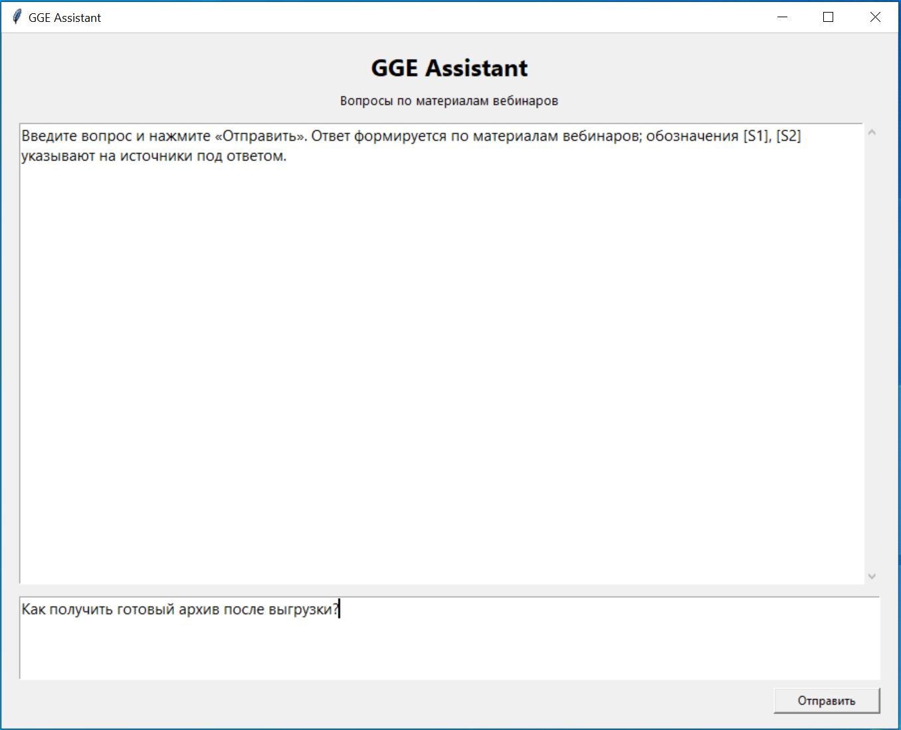
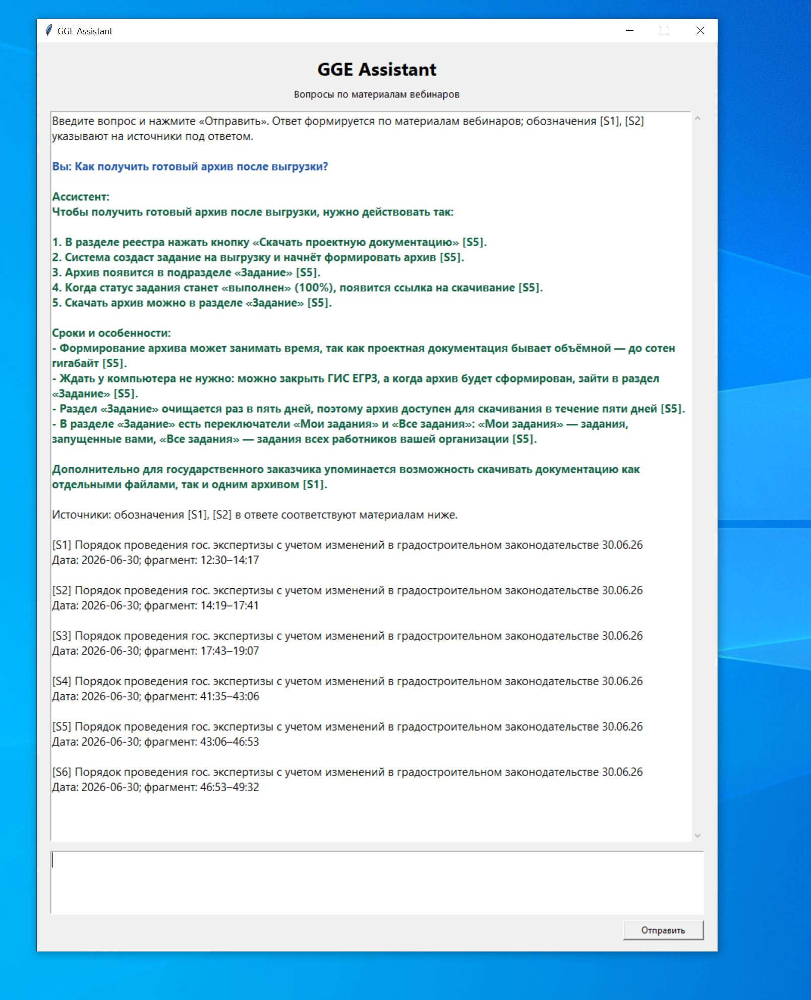
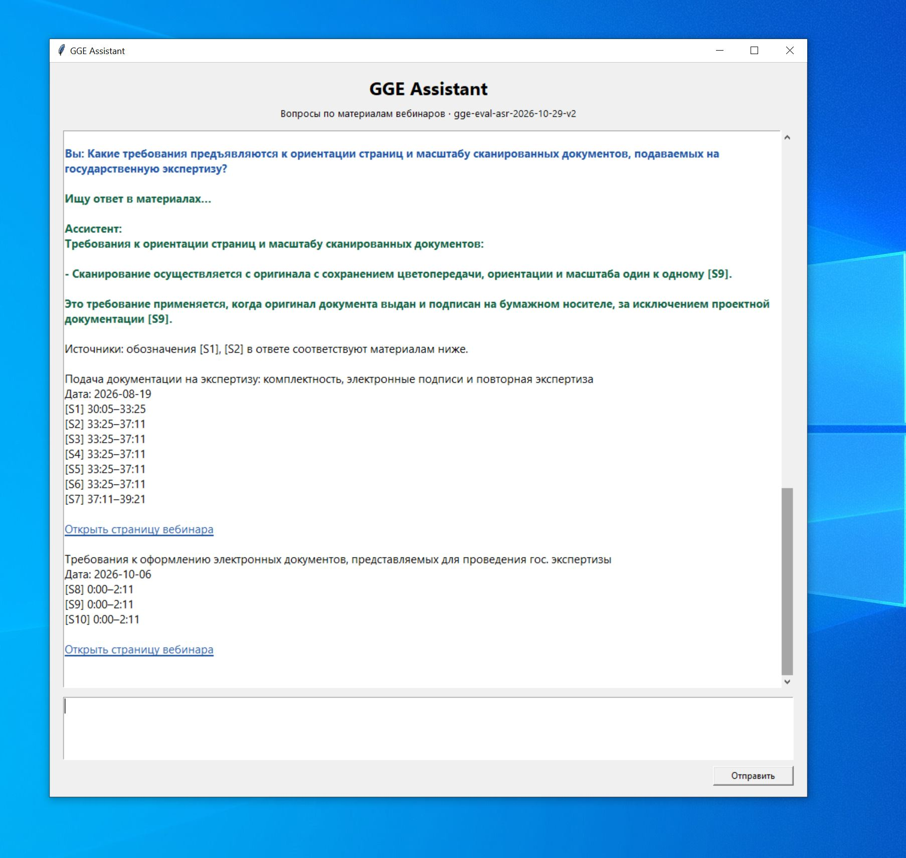
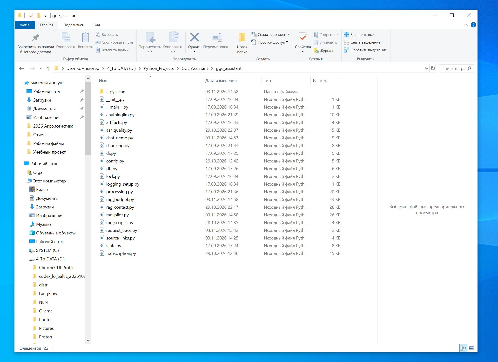
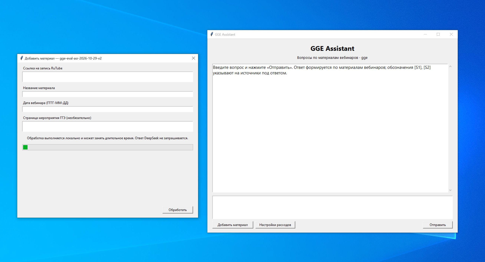
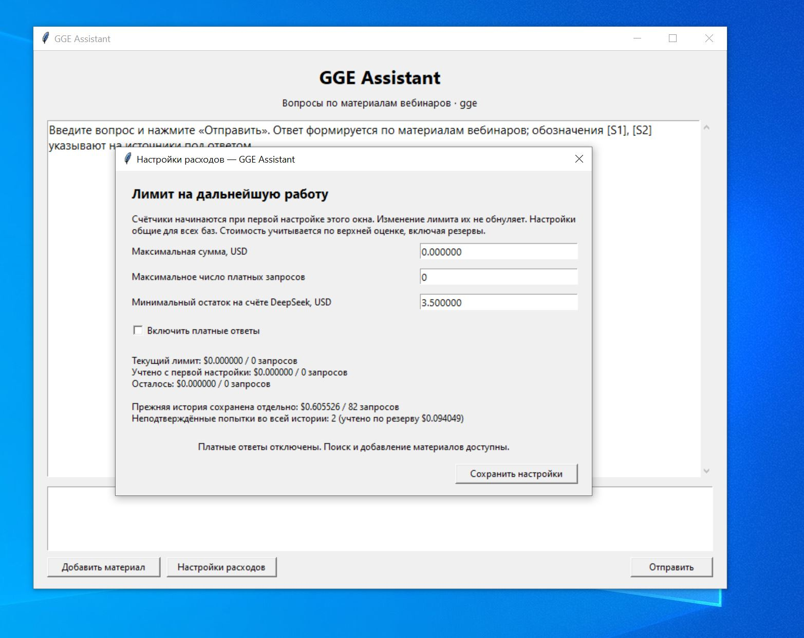

# Скринкаст и скриншоты GGE Assistant

[Открыть видео — 1 минута 16 секунд](gge-assistant-screencast.mp4) · [Скачать MP4](gge-assistant-screencast.mp4?raw=true)

Запись экрана локального запуска от 5 ноября 2026 года, с поясняющими подписями и без озвучки. Формат MP4, размер около 0,55 МБ.

В ролике показаны ввод вопроса, ответ и переход по списку источников, тайм-коды и ссылки, формы добавления материала и настройки расходов. На повторный вопрос выводится ранее полученный ответ локальной Qwen3.5 9B; новое обращение к модели и обработка вебинара в ролике не запускаются.

## Скриншоты

### Ввод вопроса

### Ответ и временные отметки

### Ответ и ссылки на источники

### Структура исходного кода

### Добавление материала

### Настройки расходов

